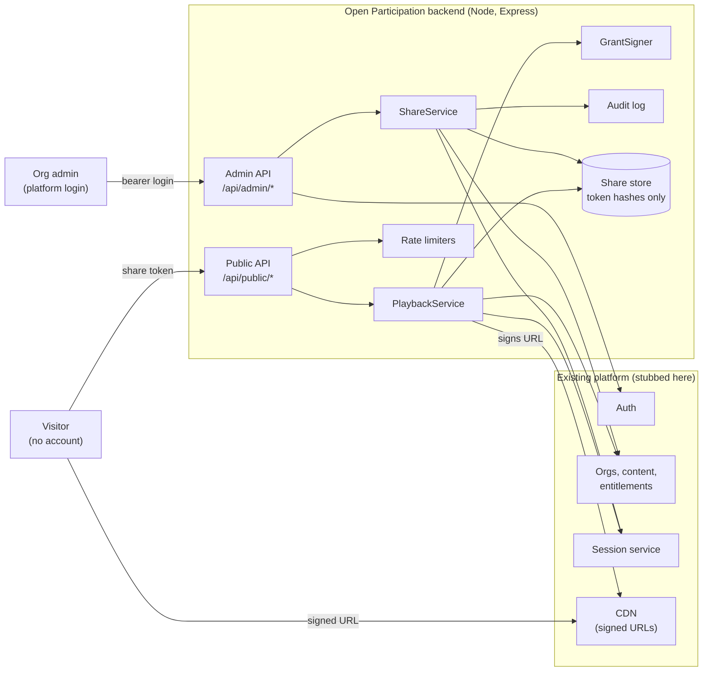
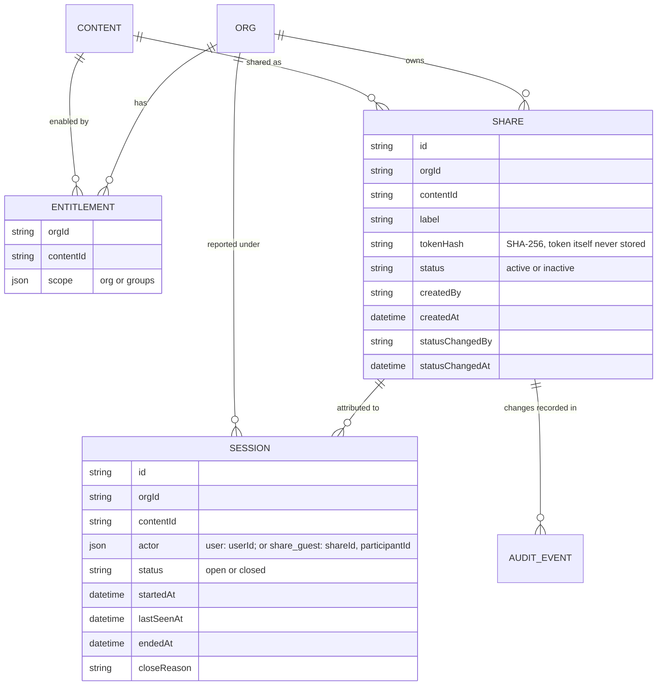
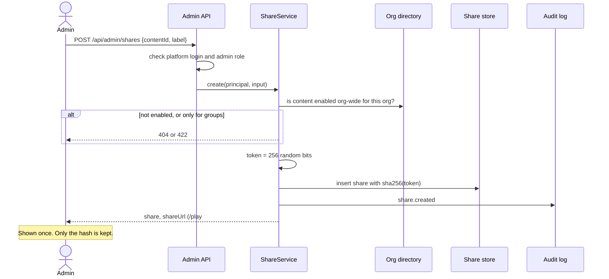
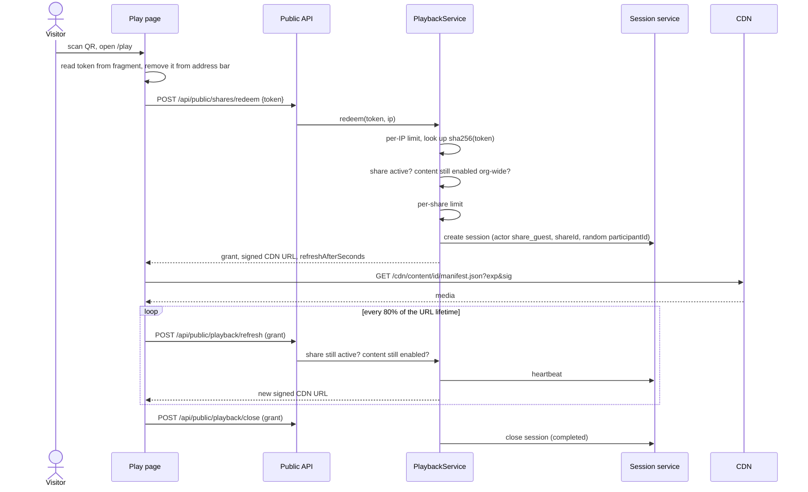
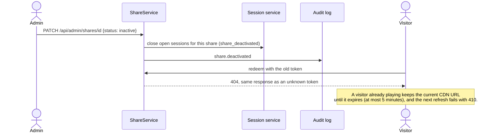
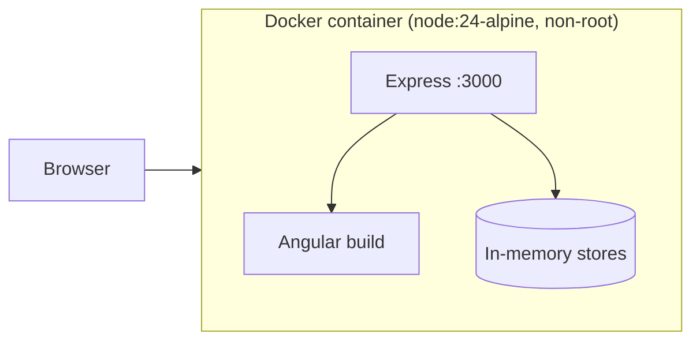

# Architecture

How Open Participation lets an anonymous visitor play one shared training without widening access to anything else.

## 1. The idea in one paragraph

An admin creates a **share** for one training. The share has a random secret token that goes into a QR code. When a visitor scans it, the backend swaps the token for two short-lived, narrowly scoped credentials: a **playback grant** (for our API) and a **signed CDN URL** (for the media). Neither credential is a platform login, and each names exactly one training, one share, one organisation and one session. Playback runs through the existing session service, with the share recorded as the actor. Deactivating the share stops new scans immediately and ends running playback within one CDN URL lifetime.

## 2. System context

The Angular app (admin page and play page) is a thin client over these APIs. It is served by the same Express process in this demo.

## 3. Components

| Component | File | Responsibility |
|---|---|---|
| Admin routes | [backend/src/routes/adminRoutes.ts](backend/src/routes/adminRoutes.ts) | Admin-only endpoints, always scoped to the admin's own organisation; builds report rows |
| Public routes | [backend/src/routes/publicRoutes.ts](backend/src/routes/publicRoutes.ts) | Redeem, refresh and close for anonymous visitors |
| ShareService | [backend/src/shares/shareService.ts](backend/src/shares/shareService.ts) | Create, list, activate and deactivate shares; entitlement checks; QR generation; audit |
| ShareRepository | [backend/src/shares/shareRepository.ts](backend/src/shares/shareRepository.ts) | Stores shares with the token's SHA-256 hash, never the token |
| PlaybackService | [backend/src/playback/playbackService.ts](backend/src/playback/playbackService.ts) | Redeem, refresh (heartbeat and re-check), close, idle sweep |
| GrantSigner | [backend/src/playback/grant.ts](backend/src/playback/grant.ts) | Signs and verifies playback grants (HMAC-SHA256, own key, audience `share-playback`) |
| AuditLog | [backend/src/audit/auditLog.ts](backend/src/audit/auditLog.ts) | Append-only record of share changes |
| Rate limiter | [backend/src/lib/rateLimit.ts](backend/src/lib/rateLimit.ts) | Per-IP and per-share limits on redeem |
| Auth stub | [backend/src/stubs/auth.ts](backend/src/stubs/auth.ts) | Demo admin and learner logins |
| Org directory stub | [backend/src/stubs/orgDirectory.ts](backend/src/stubs/orgDirectory.ts) | Organisations, content, org-wide and group entitlements |
| Session service stub | [backend/src/stubs/sessionService.ts](backend/src/stubs/sessionService.ts) | Existing create and close flow, extended with a `share_guest` actor |
| CDN stub | [backend/src/stubs/cdn.ts](backend/src/stubs/cdn.ts) | Signs URLs for one content folder with an expiry; rejects anything else |

Every component takes its dependencies through its constructor, including a clock, so tests can move time forward and the in-memory stores can be swapped for real ones.

## 4. Data model

The only change to the existing session model is the actor union: a session's actor is either a user or a share guest.

## 5. Credentials and what each can reach

| Credential | Who holds it | Lifetime | Can reach | Cannot reach |
|---|---|---|---|---|
| Platform login | Admins, learners | Existing | Admin API (admins only) | Nothing new |
| Share token | Anyone with the QR code | Until the share is deactivated | Only the redeem endpoint | Any other endpoint |
| Playback grant | One visitor, one session | 4 hours (config) | Refresh and close for its own session | Admin API, other sessions, other content |
| Signed CDN URL | One visitor | 5 minutes (config) | Files under one content folder | Any other content |

The grant and the CDN URL are signed with two different keys, and neither key is used by the platform login. A forged or edited grant fails its HMAC check.

## 6. Request flows

### Create a share

### Scan, play, close

### Deactivate

## 7. How deactivation propagates

| Path | When it stops working |
|---|---|
| New scans (redeem) | Immediately |
| Refresh and close for running playback | Immediately (session already closed) |
| CDN access for running playback | When the current signed URL expires, at most `CDN_URL_TTL_SECONDS` (5 minutes) |

The 5-minute bound is a deliberate trade-off. A CDN cannot ask our database on every request without losing the point of a CDN. A shorter TTL means more refresh calls; a real deployment could also push a revocation to the CDN for faster cut-off.

## 8. Reporting

Share guests appear in the organisation's session report next to platform users:

| Participant | Source | Training |
|---|---|---|
| Bob Learner | Platform login | Fire Safety Basics |
| Anonymous participant (anon_x7Kq…) | Share: Site gate poster | Fire Safety Basics |

Each scan gets a new random participant ID, so counts mean **plays, not unique people**. That is the honest consequence of not identifying anyone.

## 9. Security and compliance controls

| Concern | Control |
|---|---|
| Access stays narrow (requirement 1) | Grant and CDN URL scoped to one content item; grants rejected by the admin API; group-only content cannot be shared; admins only see their own organisation's shares |
| Token leakage | 256-bit token, stored as SHA-256 hash, carried in the URL fragment, removed from the address bar, never logged; `Referrer-Policy: no-referrer` |
| Guessing | Per-IP rate limit; unknown, inactive and no-longer-entitled links return the identical 404 |
| Flooding a leaked link | Per-share rate limit; admin sees play counts and can deactivate |
| Orphaned sessions | Refresh doubles as a heartbeat; idle guest sessions are closed by a sweeper |
| Tampering | HMAC-SHA256 with constant-time comparison on grants and CDN URLs |
| SOC 2 audit trail | Every create, deactivate and reactivate is recorded with actor and time |
| GDPR minimisation | No name, email, IP or device data stored for guests; IPs exist only in rate-limit memory for one minute |
| Secrets | Signing keys from environment variables; the app refuses to start in production without them |
| Transport and browser | Helmet security headers, strict CSP, `Cache-Control: no-store` on the API, 10 kB body limit |
| Container | Non-root user, read-only filesystem, `no-new-privileges` |

## 10. Deployment

One image built in three stages: Angular build, backend build, slim runtime. `scripts/deploy.sh` generates signing keys into `.env` on first run and starts it with docker compose.

## 11. What changes for production

| Demo | Production |
|---|---|
| In-memory stores | Postgres tables for shares and audit events; the real session service |
| In-memory rate limits | Redis, or limits at the WAF or edge, so they hold across instances |
| CDN stub with HMAC URLs | CloudFront signed URLs or Cloudflare token auth, using the same prefix-and-expiry model |
| Demo bearer tokens | The platform's real authentication and roles |
| Audit to memory and stdout | Immutable audit store or SIEM |
| Idle sweep in process | Scheduled job |
| Guest session retention | A retention job, for example 13 months, aligned with the organisation's reporting policy |
