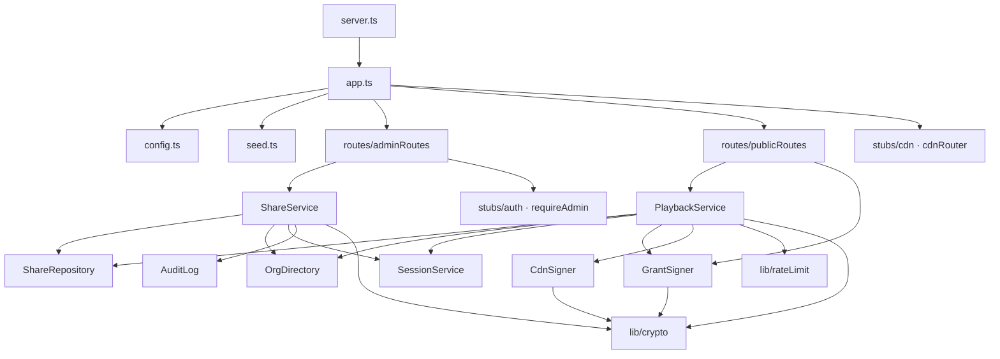

# System Architecture: Open Participation

A short overview. For the full design (mermaid diagrams, data model, sequence flows and security controls), see [ARCHITECTURE.md](ARCHITECTURE.md).

## What it does

An admin shares one training through a QR code. Anyone who scans it can play that training without an account, and the scan gives them access to nothing else.

## Layout

```
 Admin (logged in)             Visitor (no account)
      │ bearer login                 │ share token (in the URL #fragment)
      ▼                              ▼
┌───────────────────── Express :3000 (one Node process) ─────────────────────┐
│  /api/admin/*  ──► ShareService ──► ShareRepository (stores SHA-256 hash)  │
│                         │──► AuditLog (create/deactivate/reactivate)       │
│  /api/public/* ──► PlaybackService ──► GrantSigner (HMAC, own key)         │
│                         │──► Rate limiters (per IP, per share)             │
│  /cdn/*        ──► CDN stub (HMAC-signed URLs, one content folder)         │
│  /*            ──► Angular SPA (admin, play and test-cases pages)          │
│                                                                            │
│  Stubs of the existing platform: Auth · OrgDirectory/entitlements ·        │
│  SessionService (gains a new "share_guest" actor type)                     │
└────────────────────────────────────────────────────────────────────────────┘
```

## Stack

- **Backend:** Node and Express in TypeScript ([backend/src](backend/src)), with Helmet (strict CSP, `Referrer-Policy: no-referrer`). All data is held in memory. Dependencies are passed in through constructors, including a clock, so tests can control time.
- **Frontend:** Angular ([frontend/src/app](frontend/src/app)), with routes `/admin`, `/play` and `/test-cases`. In dev it proxies `/api` and `/cdn` to port 3000.
- **Tests:** [backend/test/e2e.test.ts](backend/test/e2e.test.ts) for the backend, Playwright in [ui-tests/](ui-tests/) for the UI.
- **Deploy:** A three-stage Docker image (Angular build, backend build, slim runtime on `node:24-alpine`). It runs as a non-root user on a read-only filesystem. Deployment uses docker compose through [scripts/deploy.sh](scripts/deploy.sh), or Cloud Run through [scripts/deploy-gcp.sh](scripts/deploy-gcp.sh).

## Main flow

1. **Create:** The admin calls `POST /api/admin/shares`. The training must be enabled for the whole organisation. The server makes a 256-bit token, stores only its SHA-256 hash, and returns the share URL and QR code once.
2. **Redeem:** The visitor opens `/play#token`. The page posts the token to `/api/public/shares/redeem`. The server checks the rate limits, checks that the share is active and the content is still entitled, then creates a session with a random participant ID. It returns a **playback grant** (valid 4 hours) and a **signed CDN URL** (valid 5 minutes).
3. **Refresh:** At 80% of the URL's lifetime, the page calls `/api/public/playback/refresh`. This works as a heartbeat, re-checks the share and entitlement, and issues a new CDN URL.
4. **Close or deactivate:** Deactivating a share blocks new scans immediately and closes its open sessions. Anyone already playing loses access when their current CDN URL expires, within 5 minutes at most.
5. **Sweeper:** A job runs every 60 seconds and closes guest sessions that have had no heartbeat for 15 minutes.

## Credentials

| Credential | Held by | Lifetime | What it can reach |
|---|---|---|---|
| Platform login | Admins, learners | Existing | Admin API (admins only) |
| Share token | Anyone with the QR code | Until the share is deactivated | Only the redeem endpoint |
| Playback grant | One visitor, one session | 4 hours | Refresh and close for its own session |
| Signed CDN URL | One visitor | 5 minutes | Files under one content folder |

The grant and the CDN URL are signed with separate keys, and neither key is used by the platform login.

## API surface

| Method | Path | Auth |
|---|---|---|
| GET | `/api/admin/me`, `/api/admin/content` | Admin login |
| POST / GET | `/api/admin/shares` | Admin login |
| PATCH | `/api/admin/shares/:id` | Admin login |
| GET | `/api/admin/shares/:id/sessions`, `/api/admin/reports/sessions`, `/api/admin/audit` | Admin login |
| POST | `/api/public/shares/redeem` | Share token |
| POST | `/api/public/playback/refresh`, `/api/public/playback/close` | Playback grant |
| GET | `/cdn/...` | Signed URL |
| GET | `/health`, `/healthz` | None |

## Configuration

Set through environment variables ([backend/src/config.ts](backend/src/config.ts)):

| Variable | Default |
|---|---|
| `GRANT_SIGNING_KEY`, `CDN_SIGNING_KEY` | Required in production (32+ characters) |
| `CDN_URL_TTL_SECONDS` | 300 |
| `GRANT_TTL_SECONDS` | 14400 |
| `SESSION_IDLE_TIMEOUT_SECONDS` | 900 |
| `REDEEM_LIMIT_PER_IP_PER_MINUTE` | 20 |
| `REDEEM_LIMIT_PER_SHARE_PER_MINUTE` | 120 |
| `PUBLIC_BASE_URL`, `PORT`, `TRUST_PROXY`, `STATIC_DIR` | See config.ts |

## Code layers

### Backend

Calls only go downward. Writes always go through a service. The admin routes read some stores directly for read-only views (the report, audit log and content list). Services never import Express; only the grant and auth middleware and the routers do.

```
┌──────────────────────────────────────────────────────────────────────────┐
│ 1. Bootstrap      server.ts · app.ts · config.ts · seed.ts               │
│                   Reads env, builds every object, wires Express, runs   │
│                   the idle sweeper                                       │
├──────────────────────────────────────────────────────────────────────────┤
│ 2. HTTP           routes/adminRoutes.ts   routes/publicRoutes.ts         │
│                   stubs/cdn.ts (cdnRouter)                               │
│                   Middleware: requireAdmin (auth.ts),                    │
│                   GrantSigner.middleware() (grant.ts), errorHandler      │
├──────────────────────────────────────────────────────────────────────────┤
│ 3. Services       shares/shareService.ts     playback/playbackService.ts │
│                   All business rules: entitlement checks, token issue,   │
│                   redeem/refresh/close, deactivation, idle sweep         │
├──────────────────────────────────────────────────────────────────────────┤
│ 4. Signing        playback/grant.ts (GrantSigner)                        │
│                   stubs/cdn.ts (CdnSigner)                               │
├──────────────────────────────────────────────────────────────────────────┤
│ 5. Data / ports   shares/shareRepository.ts   audit/auditLog.ts          │
│                   stubs/sessionService.ts     stubs/orgDirectory.ts      │
│                   stubs/auth.ts                                          │
│                   In-memory Maps today; real systems replace them later  │
├──────────────────────────────────────────────────────────────────────────┤
│ 6. Lib            lib/crypto.ts  lib/rateLimit.ts  lib/errors.ts         │
│                   lib/clock.ts                                           │
│                   No project imports; used by every layer above          │
└──────────────────────────────────────────────────────────────────────────┘
```

### Module dependencies



### What each file exposes

| Layer | File | Main exports |
|---|---|---|
| Bootstrap | [app.ts](backend/src/app.ts) | `createApp(config, clock)` builds everything and returns `{ app, ctx }` |
| Bootstrap | [server.ts](backend/src/server.ts) | Starts listening, runs `sweepIdleSessions()` every 60 s, handles SIGINT/SIGTERM |
| Bootstrap | [config.ts](backend/src/config.ts) | `loadConfig(env)` |
| HTTP | [adminRoutes.ts](backend/src/routes/adminRoutes.ts) | `adminRouter(deps)`, plus `reportRow()` to shape report rows |
| HTTP | [publicRoutes.ts](backend/src/routes/publicRoutes.ts) | `publicRouter(deps)` with redeem, refresh and close |
| Service | [shareService.ts](backend/src/shares/shareService.ts) | `ShareService`: `create`, `list`, `setStatus`, `sessions` |
| Service | [playbackService.ts](backend/src/playback/playbackService.ts) | `PlaybackService`: `redeem`, `refresh`, `close`, `sweepIdleSessions` |
| Signing | [grant.ts](backend/src/playback/grant.ts) | `GrantSigner`: `sign`, `verify`, `middleware()`; `grantOf(res)` |
| Signing | [cdn.ts](backend/src/stubs/cdn.ts) | `CdnSigner`: `signedUrl`, `verify`; `cdnRouter()` |
| Data | [shareRepository.ts](backend/src/shares/shareRepository.ts) | `ShareRepository`: `insert`, `get`, `findByTokenHash`, `update`, `listByOrg` |
| Data | [auditLog.ts](backend/src/audit/auditLog.ts) | `AuditLog`: `record`, `listByOrg` |
| Data | [sessionService.ts](backend/src/stubs/sessionService.ts) | `SessionService`: `create`, `heartbeat`, `close`, `get`, `list`; the `Actor` union |
| Data | [orgDirectory.ts](backend/src/stubs/orgDirectory.ts) | `OrgDirectory`: `entitlementFor`, `isShareable`, `getContent`, … |
| Data | [auth.ts](backend/src/stubs/auth.ts) | `requireAdmin`, `principalOf(res)`, `findUser` |
| Lib | [crypto.ts](backend/src/lib/crypto.ts) | `randomToken`, `sha256Hex`, `hmac`, `safeEqual`, `signPayload`, `verifyPayload` |
| Lib | [rateLimit.ts](backend/src/lib/rateLimit.ts) | `FixedWindowLimiter`: `take`, `prune` |
| Lib | [errors.ts](backend/src/lib/errors.ts) | `AppError`, `errorHandler` |
| Lib | [clock.ts](backend/src/lib/clock.ts) | `Clock` type, `systemClock` |

### How the wiring works

`createApp()` in [app.ts](backend/src/app.ts) is the only place objects are created. Each class receives its dependencies through its constructor, including the `Clock` function. That gives you two things:

- **Tests** pass a fake clock to move time forward (for example, to expire a CDN URL) without waiting.
- **Production** can replace an in-memory class (such as `ShareRepository`) with a Postgres-backed one that has the same methods, without changing any service or route.

### One request through the layers: redeem

```
POST /api/public/shares/redeem {token}
  │
  ├─ app.ts            helmet → json(10kb) → access log → Cache-Control: no-store
  ├─ publicRoutes.ts   router.post(...) → playback.redeem(token, req.ip)
  ├─ playbackService   ipLimiter.take(ip)                      (lib/rateLimit)
  │                    shares.findByTokenHash(sha256Hex(token)) (repo + lib/crypto)
  │                    status active? orgs.isShareable(...)?    (orgDirectory)
  │                    shareLimiter.take(shareId)
  │                    sessions.create({ actor: share_guest })  (sessionService)
  │                    grants.sign(...)  cdn.signedUrl(id)      (signing layer)
  ├─ publicRoutes.ts   res.status(201).json(result)
  └─ errors.ts         any AppError thrown above → { error, message } with its status
```

### Frontend

```
┌───────────────────────────────────────────────────────────────┐
│ Shell      app.ts · app.config.ts · app.routes.ts             │
├───────────────────────────────────────────────────────────────┤
│ Pages      admin/admin.page      play/play.page               │
│            test-cases/test-cases.page                         │
├───────────────────────────────────────────────────────────────┤
│ Services   api.service.ts (every HTTP call, typed responses)   │
│            theme.service.ts + theme-switch.ts (light/dark)    │
└───────────────────────────────────────────────────────────────┘
```

| File | Role |
|---|---|
| [api.service.ts](frontend/src/app/api.service.ts) | `ApiService`: admin calls (`me`, `content`, `shares`, `createShare`, `setStatus`, `report`, `audit`) and public calls (`redeem`, `refresh`, `close`, `closeOnUnload`) |
| [admin.page.ts](frontend/src/app/admin/admin.page.ts) | Pick a training, create a share, show the QR code, list shares, deactivate, report and audit views |
| [play.page.ts](frontend/src/app/play/play.page.ts) | Reads the token from `#fragment` and removes it, redeems, plays, runs the refresh timer, closes on finish or unload |
| [test-cases.page.ts](frontend/src/app/test-cases/test-cases.page.ts) | Renders [TEST_CASES.md](TEST_CASES.md) |
| [theme.service.ts](frontend/src/app/theme.service.ts) | Stores the system, light or dark theme choice |

Pages only talk to the backend through `ApiService`. They never build URLs or headers themselves.

## Changes needed for production

| Demo | Production |
|---|---|
| In-memory stores | Postgres, plus the real session service |
| In-memory rate limits | Redis, or limits at the edge |
| CDN stub | CloudFront or Cloudflare signed URLs |
| Stub auth | The platform's real login and roles |
| Audit log in memory and stdout | An immutable store or SIEM |
| Sweeper inside the process | A scheduled job |
